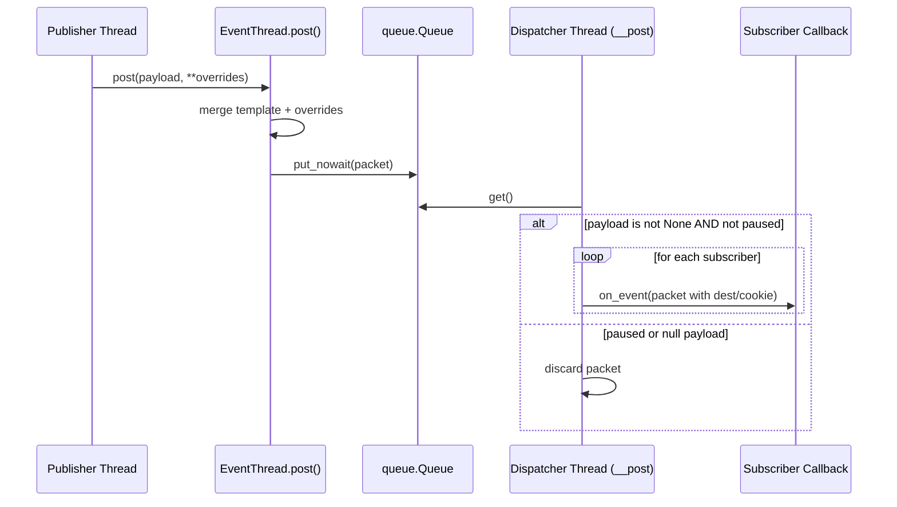
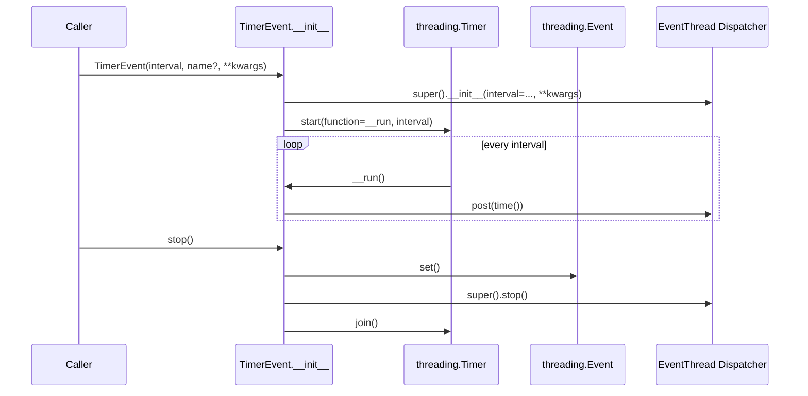

# Timer Event High-Level Design (2025-10-11)

## System Context
The `timer_event` package runs entirely within a single Python process. Client threads create `EventThread` or `TimerEvent` instances, post payloads, and receive callbacks on library-managed threads. The implementation depends on the Python standard library (`threading`, `queue`, `time`) and has no external service requirements.

```mermaid
flowchart LR
    subgraph Client Threads
        A[Publisher Thread]
        B[Consumer Modules]
    end
    subgraph timer_event Library
        C(EventThread Dispatcher Thread)
        D[[queue.Queue]]
        E[[Subscriber Callback Registry]]
    end
    subgraph Standard Library
        F(threading.Timer)
        G(threading.Event<br/>(Timer Done))
    end

    A -->|post(payload)| D
    D --> C
    C -->|invoke(packet)| B
    B -.->|subscribe() / unsubscribe()| E
    E -.-> C
    F -->|time tick| C
    G -.-> F
    B -.->|pause()/stop()| C
```

## Core Responsibilities
- **EventThread** – Owns the dispatcher thread, queue, and subscriber registry. Accepts posts from any thread and forwards packets to each subscriber sequentially.
- **TimerEvent** – Subclass of `EventThread` that schedules periodic posts using `threading.Timer` and coordinates shutdown through `threading.Event`.
- **Subscribers** – Client-provided callables invoked with the packet dictionary assembled by `EventThread`.

## Event Dispatch Sequence


## Timer-Driven Flow


## Deployment & Integration Considerations
- All callbacks execute on the dispatcher thread. Long-running or blocking work should be delegated to worker pools to prevent stalling other subscribers.
- Pausing currently drops queued packets; use `stop()` when lossless shutdown is required.
- Each `TimerEvent` instance creates both a dispatcher thread (inherited) and a dedicated `threading.Timer` thread; budget thread resources accordingly.
- The package is thread-safe at the API boundary (queue protects posts), but subscriber mutation during dispatch shares the packet object and must be handled carefully by consumers.
