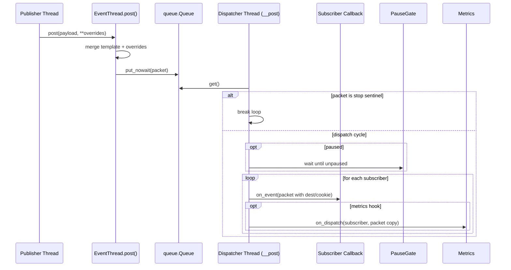
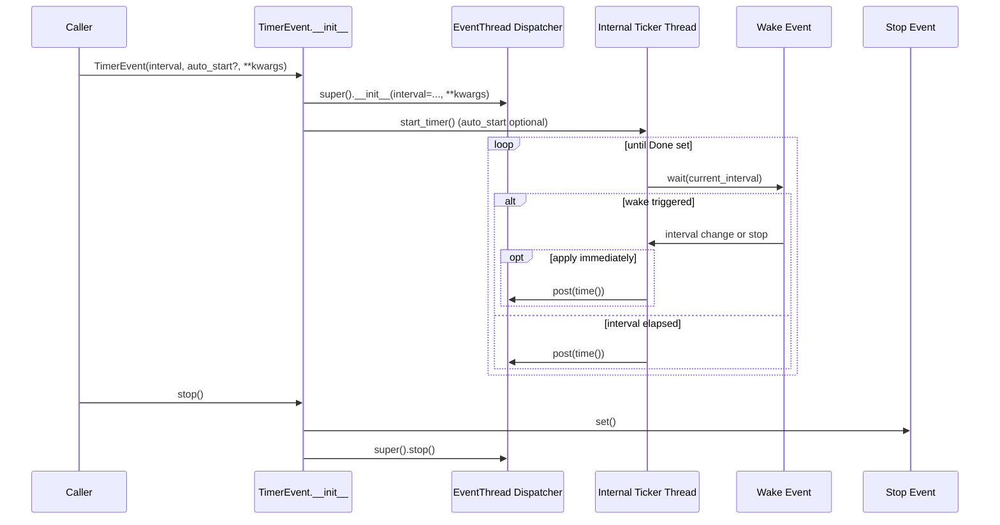

# Timer Event High-Level Design (2025-10-11)

## System Context
The `timer_event` package runs entirely within a single Python process. Client threads create `EventThread` or `TimerEvent` instances, post payloads, and receive callbacks on library-managed threads. The implementation depends on the Python standard library (`threading`, `queue`, `time`) and has no external service requirements.

```mermaid
flowchart LR
    subgraph Client Threads
        A[Publisher Thread]
        B[Consumer Modules]
    end
    subgraph timer_event Library
        C(EventThread Dispatcher Thread)
        D[[queue.Queue]]
        E[[Subscriber Callback Registry]]
    end
    subgraph Standard Library
        F(threading.Timer)
        G(threading.Event<br/>(Timer Done))
    end

    A -->|post(payload)| D
    D --> C
    C -->|invoke(packet)| B
    B -.->|subscribe() / unsubscribe()| E
    E -.-> C
    F -->|time tick| C
    G -.-> F
    B -.->|pause()/stop()| C
```

## Core Responsibilities
- **EventThread** – Owns the dispatcher thread, queue, and subscriber registry. Accepts posts from any thread and forwards packets to each subscriber sequentially. `subscribe()` returns a `SubscriptionHandle` for ergonomic tear-down.
- **TimerEvent** – Subclass of `EventThread` that runs a controllable ticker thread. It supports lazy start (`auto_start=False` + `start_timer()`), dynamic interval changes, and share the same queue/error policies as `EventThread`.
- **Subscribers** – Client-provided callables invoked with per-subscriber packet copies assembled by `EventThread`.

## Event Dispatch Sequence


## Timer-Driven Flow


## Deployment & Integration Considerations
- All callbacks execute on the dispatcher thread. Long-running or blocking work should be delegated to worker pools to prevent stalling other subscribers.
- Pausing blocks dispatch until `unpause()` is called; buffered events accumulate based on the configured overflow policy (`block`, `drop_newest`, `drop_oldest`, `error`).
- Use introspection helpers (`queue_size`, `max_queue_size`, `subscriber_count`, `is_running`, `is_paused`) plus `on_dispatch` to feed observability pipelines.
- Context manager support (`with EventThread(...)`) guarantees cleanup; `stop(wait=False)` enables non-blocking shutdown when needed.
- Each `TimerEvent` instance creates both a dispatcher thread (inherited) and an internal ticker thread; budget thread resources accordingly.
- The package is thread-safe at the API boundary (queue protects posts), and subscribers receive per-handler packet copies to avoid mutation bleed.
