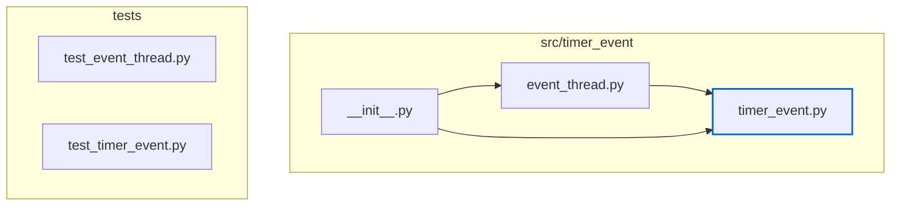
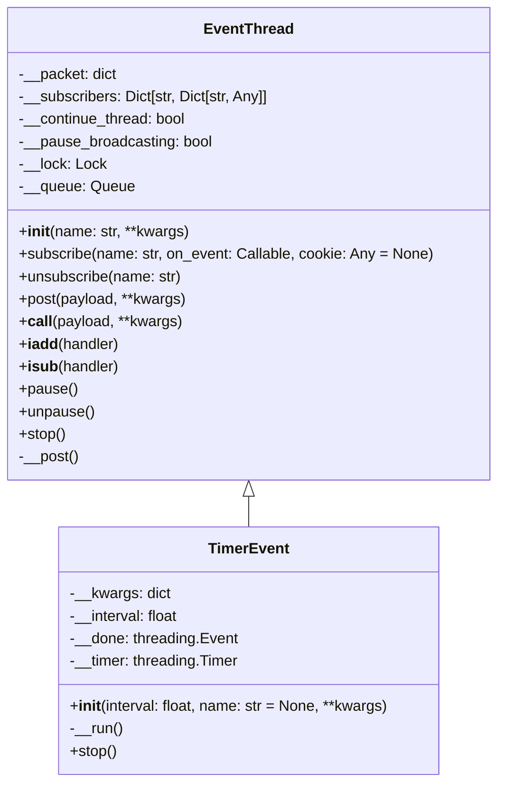
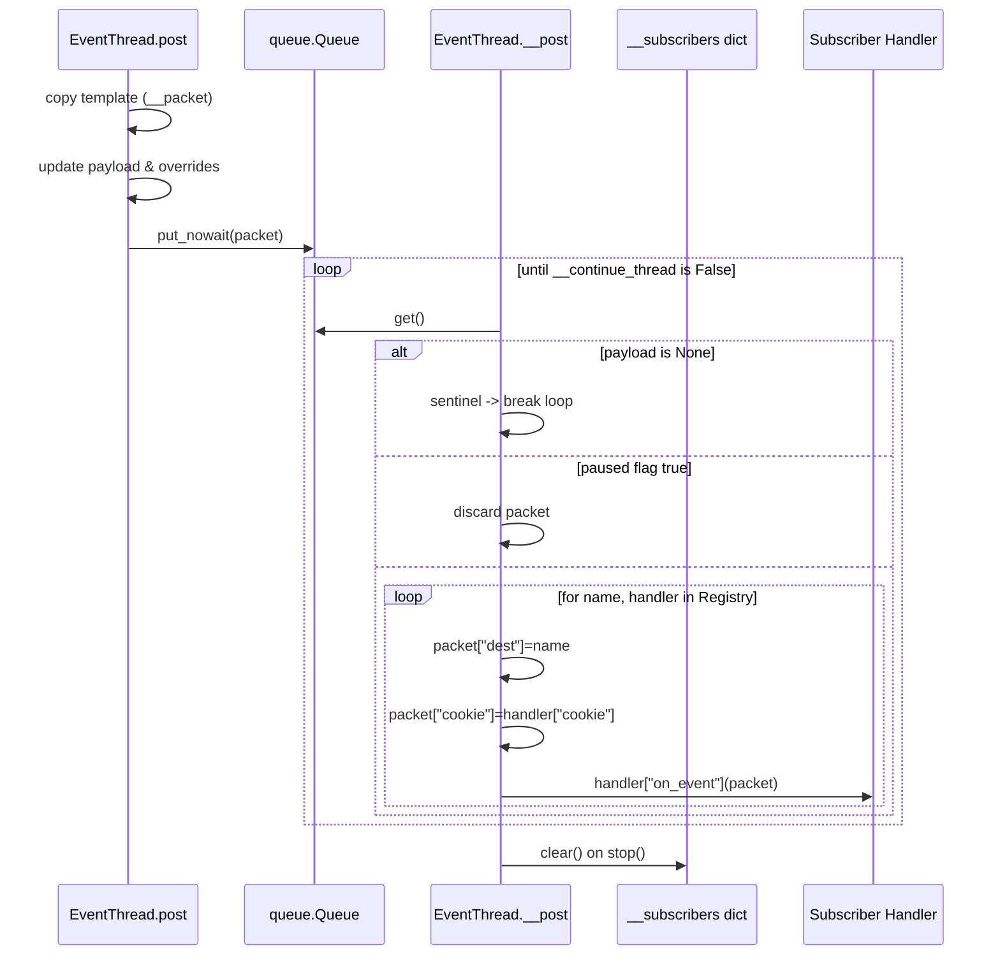
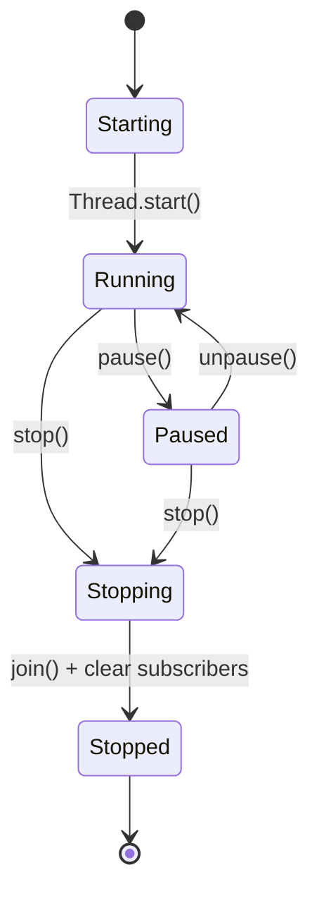
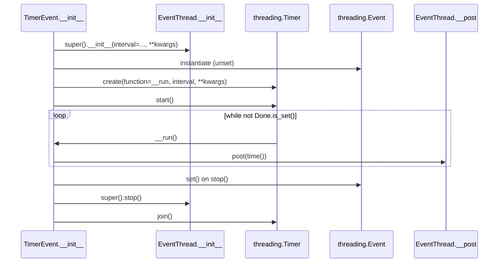

# Timer Event Low-Level Design (2025-10-11)

## Module Inventory

## Class Structure

## Internal Dispatch Workflow

## EventThread Lifecycle States

## TimerEvent Scheduling Loop

## Data Structures & Concurrency Notes
- **Packet Template (`__packet`)** – Mutable dictionary seeded during construction (`event`, optional metadata). Each `post` copies the template, merges overrides, and writes the current `payload`.
- **Subscriber Registry (`__subscribers`)** – Maps subscriber name to a dictionary containing `on_event` and `cookie`. Access is serialized with `__lock` for modifications but iteration occurs without taking a snapshot.
- **Queue (`__queue`)** – Unbounded `queue.Queue` used to hand off work between producers and the dispatcher thread.
- **Flags** – `__continue_thread` governs the dispatcher loop; `__pause_broadcasting` toggled by `pause()` / `unpause()` without locking in the latter.
- **Timer Coordination** – `TimerEvent` retains arbitrary `**kwargs` both for packet defaults and for `threading.Timer`, so callers must avoid keys unsupported by the timer constructor.

## Known Limitations (Informing Future Work)
- Dispatcher iterates over `__subscribers` while holding no lock; concurrent modification can raise `RuntimeError`.
- Paused events are discarded permanently; there is no buffering or backpressure mechanism.
- Callback exceptions propagate and terminate the dispatcher thread.
- `TimerEvent` begins emitting immediately upon construction and cannot restart once stopped.
