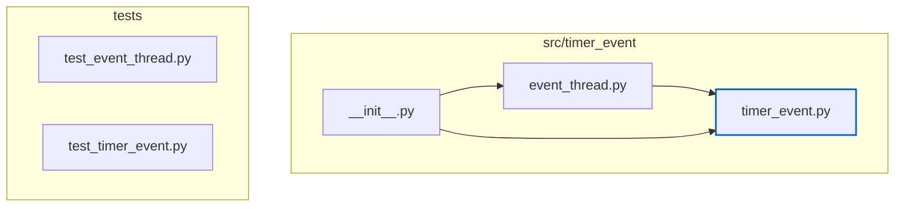
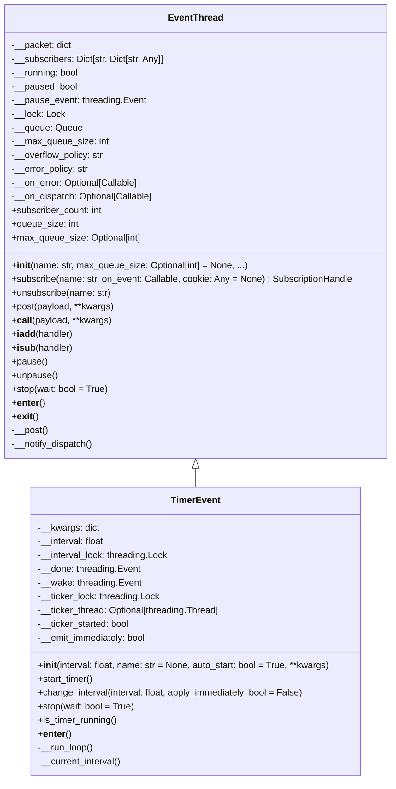
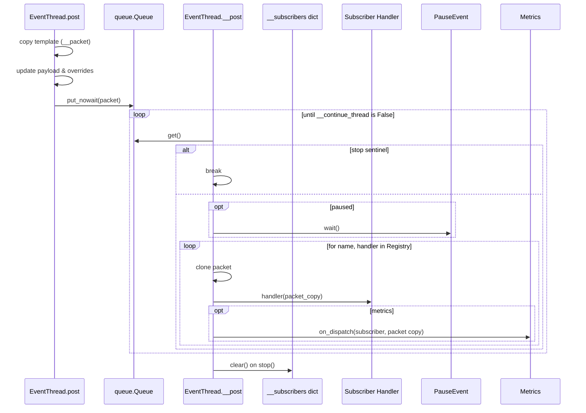
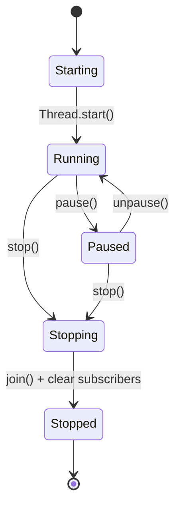
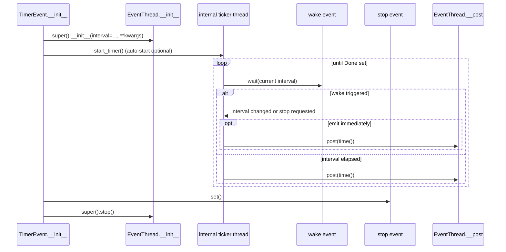

# Timer Event Low-Level Design (2025-10-11)

## Module Inventory

## Class Structure

## Internal Dispatch Workflow

## EventThread Lifecycle States

## TimerEvent Scheduling Loop

## Data Structures & Concurrency Notes
- **Packet Template (`__packet`)** – Mutable dictionary seeded during construction (`event`, optional metadata). Each `post` copies the template, merges overrides, and writes the current `payload`.
- **Subscriber Registry (`__subscribers`)** – Maps subscriber name to a dictionary containing `on_event` and `cookie`. Access is serialized with `__lock`; the dispatcher snapshots the mapping before iterating to tolerate concurrent subscription churn.
- **Queue (`__queue`)** – `queue.Queue` whose `maxsize` is governed by `max_queue_size`; overflow policy determines whether writers block, drop packets, or raise.
- **Pause Control** – `__pause_event` gates dispatch; while cleared, the dispatcher blocks before invoking subscribers but continues accepting posts into the queue.
- **Error Handling** – `__error_policy` chooses between continuing, stopping, or re-raising on subscriber failure; `__on_error` is invoked on each exception.
- **Metrics Hook** – optional `on_dispatch` callback executes after each successful subscriber invocation, receiving a copy of the packet for external observability.
- **Timer Coordination** – `TimerEvent` drives posting through a dedicated ticker thread that waits on `__wake`/`__done` events and respects runtime interval changes.

## Known Limitations (Informing Future Work)
- `queue_size` relies on `Queue.qsize()`, which is an approximation on some Python implementations; treat it as advisory telemetry.
- `on_dispatch` exceptions are logged but otherwise ignored to preserve delivery guarantees.
- `TimerEvent` instances cannot be restarted once `stop()` (or context exit) has been invoked; construct a new timer instead.
